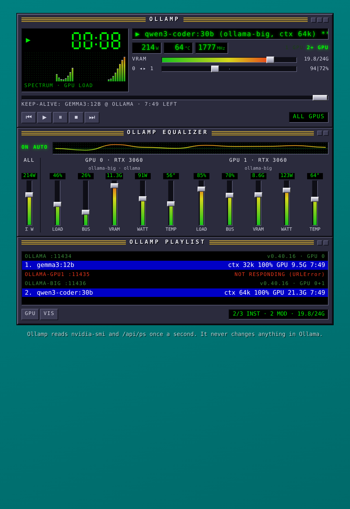

# Ollamp

A local status page for Ollama and NVIDIA GPUs, styled like classic Winamp.



- **Main window:**
  - an LCD timer for how long the GPUs have been busy without a break. It blinks with the last time when they go idle.
  - a spectrum analyzer of GPU load. Click it to switch to an oscilloscope of power draw, or to turn it off.
  - watts, temperature and clock speed
  - VRAM as the volume slider, the VRAM split between GPU 0 and 1 as the balance slider, and the time left on keep-alive as the seek bar
- **Equalizer:** load, memory bus, VRAM, watts and temperature per GPU, plus which Ollama instance runs on each card.
- **Playlist:** the loaded models per instance, with context length, share on GPU, size and keep-alive left. Models whose GPUs are busy right now are highlighted, like the track that's playing.

Buttons: ⏮/⏭ switch GPU (all, GPU 0, GPU 1, …), ⏸ pauses, ⏹ resets the timer and history.
Winamp's keys work too: z x c v b.

## What it does and doesn't do

- Once a second it runs `nvidia-smi` and calls each instance's `/api/ps` and `/api/version`. That's all.
- It never changes anything in Ollama and makes no requests outside your machine. It only needs Python 3.8+, with no packages to install.
- It has no tokens-per-second figure. Ollama doesn't expose one that a page can poll. For that, use
  `ollama run <model> --verbose` or the `eval_count`/`eval_duration` fields in the API response.
- Needs Linux and an NVIDIA GPU with `nvidia-smi`. Without one, the Ollama parts still work.

## Try it

```bash
python3 ollamp/ollamp.py
```

Open http://127.0.0.1:8088 on the same machine. To reach it from other computers on your network,
start it with `--bind 0.0.0.0` and open `http://<the machine's address>:8088`.

## Run it in the background (systemd)

```bash
sudo mkdir -p /opt/ollamp
sudo cp -r ollamp/ollamp.py ollamp/web /opt/ollamp/
sudo chmod -R a+rX /opt/ollamp
sudo cp ollamp/ollamp.service /etc/systemd/system/
sudo systemctl daemon-reload
sudo systemctl enable --now ollamp
systemctl status ollamp --no-pager
```

It then starts by itself at boot and doesn't occupy a terminal. The service runs as a temporary
user with no privileges.

Stop or restart it with `sudo systemctl stop ollamp` and `sudo systemctl restart ollamp`.

## Several Ollama instances

The default is one Ollama on port 11434. If you run more than one, list them in `ExecStart`
in `/etc/systemd/system/ollamp.service`:

```
ExecStart=/usr/bin/python3 /opt/ollamp/ollamp.py --bind 0.0.0.0 --port 8088 --instance ollama=11434 --instance ollama-big=11436
```

Then run `sudo systemctl daemon-reload && sudo systemctl restart ollamp`.

Name each instance after its systemd service (`ollama-big.service` → `ollama-big`). That's how
Ollamp tells which instance runs on which GPU. With a single instance, it matches any process called
`ollama`, so Docker and a manually started `ollama serve` work too.

If Ollama listens on another address, add `--ollama-host <address>`.

## Keep it on your local network

The page has no login. It only shows model names and GPU values and takes no commands, but it
shouldn't be reachable from the internet. Don't forward the port in your router. With ufw, allow
only your local network (change the range to match yours):

```bash
sudo ufw allow from 192.168.1.0/24 to any port 8088 proto tcp
```

To keep it on the machine itself, change `--bind 0.0.0.0` to `--bind 127.0.0.1` in the service file.

## Troubleshooting

- **"Unable to connect" from another computer:**
  - Run `sudo ss -ltnp | grep 8088`. If it shows `127.0.0.1:8088`, start Ollamp with `--bind 0.0.0.0`.
  - If it shows `0.0.0.0:8088`, a firewall is blocking the port.
- **"nvidia-smi failed":** run `nvidia-smi` as a normal user. If it works there but not in the
  service, replace `DynamicUser=yes` with `User=ollama` (or another user that can use the GPU).
- **An instance shows "NOT RESPONDING":** check `curl -s http://127.0.0.1:11434/api/version`.
- **No instance names under the GPUs:** some drivers and containers hide the process list from
  `nvidia-smi`. Everything else still works.

## License

MIT, see [LICENSE](LICENSE).

Ollamp is an independent project. It is not affiliated with or endorsed by Winamp or Ollama.
The look is drawn from scratch in CSS and canvas, inspired by classic media players; it contains
no Winamp skins, graphics, logos or code.

## Uninstall

```bash
sudo systemctl disable --now ollamp
sudo rm /etc/systemd/system/ollamp.service
sudo rm -rf /opt/ollamp
sudo systemctl daemon-reload
```
